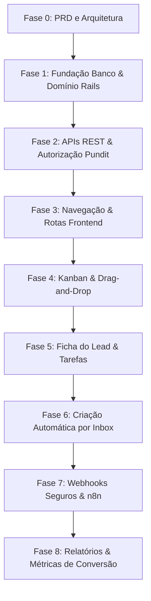

# PRD — CRM Imobiliário e Kanban Nativo para Chatwoot

---

## 1. Visão geral

Este projeto é um fork próprio do Chatwoot Community Edition, destinado a uma imobiliária brasileira.

O objetivo é criar um módulo de CRM imobiliário com Kanban de vendas totalmente nativo dentro da interface do Chatwoot. O módulo não será um iframe, plugin externo ou aplicação separada. Ele deve ser incorporado diretamente ao layout do sistema e exibido no menu lateral principal com o nome **“Funil de Vendas”**.

A experiência e os fluxos são inspirados conceitualmente nas melhores práticas de CRMs e Kanbans de vendas do mercado, porém todo o código, telas, estrutura de banco de dados, regras de negócio e integrações devem ser **100% originais**. Não é permitida a cópia de código-fonte, layout visual proprietário, banco de dados, modelos ou licenças de produtos de terceiros.

O sistema tem como finalidade primordial organizar o fluxo de entrada e qualificação de leads imobiliários recebidos por diversos canais: WhatsApp, Instagram Direct, Meta Ads, Google Ads, formulários de website, portais imobiliários (Zap, VivaReal, Imovelweb, etc.), indicações e captações diretas. O foco central é **impedir que leads esfriem**, assegurar acompanhamento ágil, padronizar a distribuição entre corretores e garantir visibilidade total sobre visitas, propostas, negociações, fechamentos e motivos de descarte.

---

## 2. Problema a resolver

No modelo padrão do Chatwoot, as conversas são excelentes para atendimento conversacional multicanal imediato, mas não atendem à dinâmica de um ciclo comercial imobiliário:

1. **Ciclo de venda longo e assíncrono**: Uma transação imobiliária (compra, locação ou captação) dura tipicamente semanas ou meses, envolve múltiplos contatos presenciais e telefônicos e pode abarcar várias conversas fragmentadas no WhatsApp ao longo do tempo.
2. **Falta de visibilidade do funil comercial**: Gestores e corretores não possuem visão consolidada de quantos clientes estão em triagem, quantos já visitaram imóveis ou quantas propostas formais estão sob análise.
3. **Leads esfriando sem próxima ação**: Clientes deixam de ser atendidos por falta de uma data e descrição explícita de "próximo passo" (follow-up).
4. **Dificuldade de gestão da carteira do corretor**: Falta clareza sobre qual corretor é o responsável direto pela negociação e quais imóveis estão em pauta.
5. **Histórico comercial disperso**: Mudanças de propostas, renegociações de valores e motivos de descarte não ficam registrados estruturadamente.
6. **Ausência de métricas de conversão**: Inexistência de taxas consolidadas de conversão por canal de origem (Meta Ads vs. Portais), por corretor ou por faixa de valor do imóvel.
7. **Isolamento entre ferramentas**: Dificuldade em unificar o atendimento do Chatwoot com campanhas de marketing, automações no n8n e dashboards externos da imobiliária.

---

## 3. Objetivos do produto

### Objetivos principais

* **Kanban Nativo Integrado**: Desenvolver uma visão Kanban no frontend do Chatwoot, acessível diretamente no menu lateral com a legenda **“Funil de Vendas”**.
* **Gestão Completa de Oportunidades**: Permitir criação, visualização detalhada, edição, movimentação por drag-and-drop, filtros, busca e atribuição de cards comerciais.
* **Vínculo Seguro com o Core**: Vincular cada card obrigatoriamente a um contato (`Contact`) e opcionalmente a uma conversa (`Conversation`) existente no Chatwoot.
* **Funis e Etapas Flexíveis por Account**: Permitir estruturação de funis por conta, disponibilizando de imediato o funil padrão de vendas imobiliárias.
* **Controle Operacional Rigoroso**: Gerenciar responsáveis (corretores), tarefas de follow-up, agendamentos de visita, propostas de compra/locação, valores estimados, valores finais e motivos de perda.
* **Isolamento Multi-Tenant Estrito**: Garantir isolamento rigoroso por `account_id` em 100% das consultas, models, controllers e policies Pundit, seguindo as diretrizes nativas do Chatwoot.
* **Preparação para Automações e Webhooks**: Criar eventos de domínio bem arquitetados para plugar fluxos no n8n, Meta Ads, Google Calendar e painéis de Business Intelligence.
* **Arquitetura Modular Anti-Conflito**: Desenvolver o módulo de forma isolada em namespace próprio para manter a compatibilidade com futuros rebases e atualizações do repositório upstream do Chatwoot.

### Objetivos secundários

* **Redução Drástica do Tempo de Resposta**: Garantir que novos leads imobiliários recebam atendimento rápido e qualificado.
* **Cultura de Follow-up Comercial**: Estimular disciplina entre corretores por meio de tarefas com prazos e status.
* **Previsibilidade Financeira**: Proporcionar ao gestor a visualização do volume financeiro total em propostas e negociações em andamento.
* **Evolução Multi-Funil**: Preparar o sistema para suportar nativamente funis paralelos de Locação e Captação de Imóveis no futuro.

---

## 4. Não objetivos

Para assegurar estabilidade, foco e entrega segura do MVP inicial, os seguintes itens estão explicitamente **fora de escopo**:

* **Não alterar arquivos da pasta `enterprise`**: O projeto é baseado estritamente na versão Community Edition (OSS).
* **Não copiar código ou interfaces proprietárias**: Nenhuma linha de código ou layout visual de outros CRMs comerciais deve ser reproduzida.
* **Não modificar canais e inboxes existentes**: Não alterar os drivers ou lógicas de envio/recebimento de mensagens de WhatsApp, Instagram, Email, SMS ou Webchat do Chatwoot.
* **Não substituir telas nativas do Chatwoot**: As telas de conversas, lista de contatos, agentes, etiquetas e relatórios nativos permanecem inalteradas.
* **Sem módulo financeiro no MVP**: Emissão de boletos, split de pagamentos, cálculo complexo de comissões e gestão de contratos jurídicos não fazem parte do MVP.
* **Sem IA conversacional ou bots no MVP**: Geração de respostas automáticas por IA ou qualificação preditiva automática não entram nesta etapa.
* **Sem relatórios estatísticos complexos no MVP**: Métricas avançadas de BI serão desenvolvidas após a consolidação da coleta de dados das negociações.
* **Sem conexões externas não homologadas**: Nenhuma chamada síncrona a serviços externos será acoplada ao fluxo de interface do usuário.
* **Sem deploy direto sem testes**: Não realizar deploys ou migrações em ambientes de produção sem homologação prévia, testes e backups completos.

---

## 5. Usuários e permissões

O sistema adota o modelo de autorização do Chatwoot baseado em **Pundit**, com segregação de papéis entre Administradores e Corretores/Agentes.

### Administrador / Gestor Imobiliário

* **Visibilidade Global da Conta**: Acesso integral a todos os funis, etapas, cards, tarefas, históricos e notas de todos os corretores da account.
* **Gestão Estrutural**: Capacidade de criar, renomear, reordenar, ativar ou desativar funis comerciais e etapas do Kanban.
* **Gestão de Motivos de Perda**: Cadastro, edição e desativação das opções da lista de motivos de perda/descarte.
* **Distribuição e Reatribuição**: Criar oportunidades e redistribuir cards entre corretores a qualquer momento.
* **Monitoramento Operacional**: Visualização destacada de cards sem corretor atribuído, negociações estagnadas ou tarefas em atraso.
* **Configurações de Integração**: Gerenciamento futuro de webhooks, chaves e parametrizações com o n8n.

### Corretor / Agente

* **Visibilidade Focada**: Visualização dos cards atribuídos diretamente a ele, além de acesso aos cards da fila geral (sem corretor atribuído), conforme política comercial da imobiliária.
* **Gestão Operacional de Cards**: Criação de novas oportunidades, atualização de dados cadastrais do negócio, edição de valor, alteração de prioridade, preenchimento de próxima ação e movimentação entre colunas.
* **Gestão de Atividades e Tarefas**: Inclusão de notas internas, agendamento de visitas, marcação de tarefas concluídas e registro de feedbacks de clientes.
* **Navegação Integrada**: Abertura direta da conversa de WhatsApp/chat do cliente a partir do card.
* **Restrições Estritas**: Não tem permissão para alterar a estrutura de etapas do funil, editar motivos de perda ou acessar parametrizações do sistema.

### Regra inicial de visibilidade e segurança

| Ação / Recurso | Administrador / Gestor | Corretor / Agente |
|---|:---:|:---:|
| Ver cards atribuídos a si | Sim | Sim |
| Ver cards sem responsável | Sim | Sim |
| Ver cards de outros corretores | Sim | Não (no MVP padrão) |
| Criar e editar cards | Sim | Sim |
| Mover cards de etapa | Sim | Sim |
| Registrar tarefas e notas | Sim | Sim |
| Criar/alterar etapas e funis | Sim | Não |
| Gerenciar motivos de perda | Sim | Não |
| Configurar integrações e webhooks | Sim | Não |

*Nota: Toda a camada de autorização deve residir em policies Pundit dedicadas, garantindo que mesmo requisições diretas de API respeitem rigorosamente o perfil do usuário autenticado.*

---

## 6. Conceitos do domínio

| Conceito | Descrição no Domínio Imobiliário |
|---|---|
| **Account** | A conta/empresa no Chatwoot (a imobiliária). É a raiz mandatória de isolamento de todos os registros. |
| **Contact** | O cliente (comprador, inquilino ou proprietário). Todo card comercial deve estar obrigatoriamente associado a um contato. |
| **Conversation** | A sessão de conversa em um canal (WhatsApp, Instagram, etc.). O vínculo com a oportunidade é opcional. |
| **Pipeline** | O funil comercial completo (ex: "Vendas Imobiliárias", "Locação Residencial", "Captação de Lançamentos"). |
| **Pipeline Stage** | Uma coluna/fase dentro de um funil (ex: "Novo Lead", "Visita Agendada", "Proposta"). |
| **Deal** | O card da oportunidade comercial. Representa a negociação imobiliária específica. |
| **Deal Activity** | Registro cronológico, imutável e auditável de cada evento ocorrido com a oportunidade. |
| **Deal Task** | Tarefa ou compromisso comercial com data/hora (ex: ligação de qualificação, visita presencial, cobrança de certidões). |
| **Loss Reason** | O motivo padronizado pelo qual uma negociação foi perdida ou descartada. |
| **Assignee** | O usuário (corretor de imóveis) responsável pelo card ou tarefa. |

### Regra de ouro da arquitetura de domínio

> **Um card representa uma oportunidade comercial e jamais uma conversa.**

1. Um `Contact` pode possuir múltiplas oportunidades (`Deals`) simultâneas ou ao longo da vida (ex: um cliente comprando um apartamento e colocando outro para alugar).
2. Uma conversa de chat pode ser finalizada/resolvida pelo suporte ou triagem sem que a negociação imobiliária seja encerrada.
3. Se um cliente reabrir contato 3 meses depois para tirar dúvidas sobre a escritura, o mesmo card de negociação continua ativo, podendo se associar à nova conversa ativa.
4. Oportunidades comerciais podem ser criadas manualmente para clientes recebidos no plantão de vendas ou por telefone, sem nenhuma conversa prévia de chat.

---

## 7. Funil padrão inicial

Ao inicializar uma conta ou executar o setup do módulo, o sistema disponibilizará o seguinte funil padrão:

```text
Funil de Vendas Imobiliárias
```

### Estrutura das etapas

| Ordem | Etapa | Tipo técnico | Final? | Descrição e Critério de Entrada |
|:---:|---|:---:|:---:|---|
| **1** | **Novo Lead** | `open` | Não | Lead recém-chegado via canal digital ou cadastro manual, ainda não abordado. |
| **2** | **Em Atendimento** | `open` | Não | Corretor estabeleceu contato e iniciou a conversa exploratória. |
| **3** | **Qualificando** | `open` | Não | Levantamento detalhado de perfil: faixa de preço, bairros, forma de pagamento, financiamento e urgência. |
| **4** | **Visita Agendada** | `open` | Não | Imóvel(is) selecionado(s) e visita presencial/virtual formalmente marcada com data e hora. |
| **5** | **Visita Realizada** | `open` | Não | Visita concluída; aguardando percepção do cliente e alinhamento de interesse. |
| **6** | **Proposta Enviada** | `open` | Não | Proposta formal de compra/locação apresentada ao proprietário/incorporadora. |
| **7** | **Em Negociação** | `open` | Não | Análise de crédito imobiliário, contraproposta de valores ou checagem documental. |
| **8** | **Ganho** | `won` | Sim | Negócio fechado: contrato assinado e sinal/comissão formalizada. |
| **9** | **Perdido** | `lost` | Sim | Oportunidade descontinuada: descarte documentado com motivo obrigatório. |

### Regras de transição de status

* As colunas `Ganho` e `Perdido` possuem comportamentos de finalização:
  * Ao arrastar para `Ganho`: status do deal passa para `won`, registrando opcionalmente o valor real fechado e a data de fechamento.
  * Ao arrastar para `Perdido`: abre-se modal obrigatório exigindo a seleção de um `Loss Reason` e campo para justificativa textual; o status passa para `lost`.
  * Ao mover para qualquer uma das etapas anteriores (1 a 7): o status é mantido ou reaberto como `open`, limpando motivos de perda.
* Toda e qualquer transição gera automaticamente um registro em `crm_deal_activities`.

---

## 8. Dados do card de oportunidade

### Atributos estruturados na tabela `crm_deals`

| Campo | Tipo no Banco | Obrigatório | Descrição / Regra |
|---|---|:---:|---|
| `account_id` | `bigint` | Sim | ID da conta (chave mandatória de isolamento multi-tenant). |
| `crm_pipeline_stage_id` | `bigint` | Sim | Etapa atual do funil em que o card está posicionado. |
| `contact_id` | `bigint` | Sim | Contato vinculado (cliente comprador/locatário). |
| `conversation_id` | `bigint` | Não | Conversa de origem ou conversa ativa no Chatwoot (opcional). |
| `assignee_id` | `bigint` | Não | Corretor responsável (referencia a tabela `users.id`). |
| `title` | `string` | Sim | Título do card (ex: "Casa Alphaville — Carlos Eduardo"). |
| `value` | `decimal(14,2)` | Sim | Valor estimado da transação em Reais (default: `0.00`). |
| `currency` | `string` | Sim | Moeda oficial, padrão fixo `BRL`. |
| `final_value` | `decimal(14,2)` | Não | Valor real de fechamento obtido na etapa de ganho. |
| `status` | `integer (enum)` | Sim | Enumeração: `open` (0), `won` (1), `lost` (2). |
| `priority` | `integer (enum)` | Sim | Enumeração: `low` (0), `medium` (1), `high` (2), `urgent` (3). |
| `source` | `string` | Não | Canal de origem do lead (ex: `meta_ads`, `portal_zap`). |
| `business_type` | `integer (enum)` | Não | Enumeração: `sale` (0), `rental` (1), `listing` (2). |
| `next_action` | `string` | Não | Descrição curta da próxima atividade comercial obrigatória. |
| `next_action_at` | `datetime` | Não | Prazo limite para a execução da próxima ação. |
| `closed_at` | `datetime` | Não | Timestamp exato em que o negócio foi marcado como ganho ou perdido. |
| `crm_loss_reason_id` | `bigint` | Não | ID do motivo de descarte cadastrado (obrigatório se `status: lost`). |
| `loss_notes` | `text` | Não | Detalhamento complementar do motivo do descarte. |
| `position` | `integer` | Sim | Ordenação visual vertical do card dentro da coluna (default: 0). |
| `last_activity_at` | `datetime` | Não | Timestamp da última interação comercial relevante. |
| `custom_attributes` | `jsonb` | Sim | Armazenamento de campos flexíveis do mercado imobiliário (default: `{}`). |

### Campos mapeados dentro de `custom_attributes` (JSONB)

Os seguintes campos são padronizados no JSONB para preservar a flexibilidade sem necessidade de constantes migrations:

```text
property_code           # Código de referência do imóvel no catálogo (ex: AP-402)
property_name           # Nome/título do imóvel
property_type           # Tipo: apartamento, casa, terreno, comercial, rural
development_name        # Nome do empreendimento / condomínio / edifício
city                    # Cidade de interesse
neighborhood            # Bairro de interesse
bedrooms                # Quantidade de dormitórios desejada (ex: "3", "4+")
parking_spaces          # Vagas de garagem desejadas
budget_min              # Orçamento mínimo declarado
budget_max              # Orçamento máximo declarado
desired_move_in_date    # Previsão desejada de mudança
financing_status        # Situação do financiamento (à vista, aprovado, em análise)
lead_temperature        # Temperatura: hot (quente), warm (morno), cold (frio)
campaign_name           # Nome da campanha no Meta Ads / Google Ads
adset_name              # Nome do conjunto de anúncios
ad_name                 # Nome do criativo/anúncio específico
utm_source              # UTM Source capturado na conversão
utm_medium              # UTM Medium
utm_campaign            # UTM Campaign
portal_name             # Nome do portal imobiliário parceiro de onde o lead veio
notes_summary           # Síntese das necessidades prioritárias do cliente
```

### Valores padronizados

* **Origens do Lead (`source`)**: `meta_ads`, `instagram`, `google`, `website`, `portal`, `referral`, `organic`, `whatsapp_direct`, `other`.
* **Tipo de Negócio (`business_type`)**: `sale` (Venda), `rental` (Locação), `listing` (Captação de Imóvel).
* **Temperatura Comercial (`lead_temperature`)**: `hot`, `warm`, `cold`.

---

## 9. Funcionalidades planejadas

### Visualização do Funil e Kanban

* **Colunas Dinâmicas**: Interface em colunas responsivas, exibindo a contagem de cards e o somatório financeiro total de oportunidades ativas em cada etapa.
* **Drag-and-Drop Fluido**: Movimentação de cards entre etapas e ordenação vertical com a biblioteca `vuedraggable` (SortableJS).
* **Atualização Otimista Segura**: Movimentação visual imediata no frontend, com reversão automática de posição e alerta amigável na tela se a requisição backend falhar.
* **Identificação Visual**: Badges visuais destacando nível de prioridade, temperatura do lead, tarefas atrasadas e alertas de lead estagnado.
* **Barra Superior de Métricas**: Indicadores rápidos de Total de Cards, Valor em Aberto, Valor Fechado e Taxa de Conversão.

### Gestão e Operação de Cards

* **Criação Manual Intuitiva**: Modal simples para criar um card digitando o contato (com autocomplete de contatos existentes ou criação rápida de novo contato), título e valor.
* **Edição Completa**: Alteração de corretor responsável, prioridade, próxima ação e preenchimento dos dados imobiliários complementares.
* **Acesso Rápido ao Atendimento**: Botão no próprio card que redireciona o usuário com 1 clique para a tela de conversa do WhatsApp/chat no Chatwoot.
* **Acesso à Ficha do Contato**: Atalho para visualização dos dados cadastrais do contato.
* **Arquivamento Seguro**: Oportunidades perdidas ou ganhas não sofrem deleção física do banco de dados, permitindo reabertura ou auditoria.

### Tarefas e Compromissos do Corretor

* **Agendamento com Tipo**: Registro de tarefas com tipificação clara: *Visita*, *Ligação*, *Follow-up*, *Envio de Proposta*, *Documentação*.
* **Prazo e Atribuição**: Data/hora limite de execução e corretor encarregado.
* **Checklist Operacional**: Marcação rápida de tarefa como concluída, reagendamento com novo prazo e histórico de conclusões.

### Fechamento de Negócios (Ganho e Perda)

* **Fluxo de Ganho**: Registro do valor final acordado e congelamento da oportunidade como sucesso comercial.
* **Fluxo de Descarte com Perda Qualificada**: Modal obrigatório exigindo a seleção do motivo do descarte (ex: "Preço fora do orçamento", "Imóvel indisponível", "Comprou com outro corretor", "Reprovado no financiamento") e campo de anotações.

### Pesquisa e Filtros Rápidos

* **Busca Textual Abrangente**: Busca em tempo real por nome do contato, telefone, e-mail, título do card ou código de referência do imóvel.
* **Filtros Segmentados**: Filtro por corretor responsável, etapa, origem do lead, tipo de negócio, prioridade e intervalo de datas.

### Painel de Detalhes da Oportunidade

* **Drawer Lateral / Modal Completo**: Exibição centralizada contendo:
  * Linha do tempo completa de movimentações e notas (*Timeline*).
  * Painel de tarefas pendentes e concluídas.
  * Resumo das características do imóvel procurado.
  * Dados de contato e histórico de interações.

---

## 10. Integração futura com n8n

O módulo é projetado desde o primeiro dia para suportar integração assíncrona desacoplada com o **n8n**, sem que regras externas interfiram no núcleo transacional do Chatwoot.

### Objetivos da integração com n8n

* Executar cadências de follow-up automatizadas em leads inativos.
* Enviar lembretes e confirmações de visita via WhatsApp tanto para o cliente quanto para o corretor.
* Sincronizar visitas agendadas diretamente com o Google Calendar da equipe.
* Alimentar dashboards gerenciais externos (Supabase, PostgreSQL analítico, planilhas ou Metabase).
* Disparar eventos de conversão de volta para a API de Conversões do Meta Ads (CAPI) e Google Ads quando um lead for qualificado ou ganho.

### Eventos de domínio padronizados

| Nome do Evento | Gatilho de Disparo |
|---|---|
| `crm.deal_created` | Uma nova oportunidade comercial é registrada. |
| `crm.deal_updated` | Informações de valor, dados do imóvel ou campos do card são modificados. |
| `crm.deal_stage_changed` | O card é movido para uma nova etapa do funil. |
| `crm.deal_assigned` | A oportunidade é atribuída ou transferida para outro corretor. |
| `crm.deal_task_created` | Uma nova tarefa comercial é cadastrada. |
| `crm.deal_task_completed` | O corretor conclui uma tarefa agendada. |
| `crm.deal_task_due` | A tarefa se aproxima da data/hora de vencimento. |
| `crm.deal_task_overdue` | A tarefa ultrapassa o prazo sem conclusão. |
| `crm.deal_won` | A negociação é concluída com sucesso (`won`). |
| `crm.deal_lost` | A oportunidade é descartada como perdida (`lost`). |
| `crm.deal_inactive` | Card sem interação por mais de X dias úteis (alerta de estagnação). |

### Requisitos de segurança e entrega de webhooks

1. **Configuração por Account**: Endpoint URL e chave de segredo configurados individualmente por conta.
2. **Assinatura HMAC Criptográfica**: Cada requisição enviará um header com hash HMAC-SHA256 (ex: `X-CRM-Signature`) para verificação de autenticidade no n8n.
3. **Idempotência Garantida**: Envio de um `event_id` único no cabeçalho e payload para evitar reprocessamento em caso de retentativas.
4. **Execução Assíncrona no Sidekiq**: Nenhuma chamada HTTP externa será executada na thread de requisição do usuário. O Sidekiq processará os envios em background com retry exponencial.
5. **Auditoria de Envios**: Registro dos últimos disparos, status HTTP retornado e payload para diagnóstico em caso de falha.
6. **Proteção de Credenciais**: Nenhuma chave, webhook ou segredo será transmitido para o cliente frontend.

### Exemplo de contrato de payload JSON (Referência)

```json
{
  "event": "crm.deal_stage_changed",
  "event_id": "c7a8b64e-3995-4eb4-b9b2-386663f73889",
  "occurred_at": "2026-10-10T16:35:00Z",
  "account_id": 1,
  "deal": {
    "id": 245,
    "title": "Apartamento 3 Quartos — Jardins",
    "business_type": "sale",
    "source": "meta_ads",
    "value": "750000.00",
    "currency": "BRL",
    "priority": "high",
    "custom_attributes": {
      "property_code": "AP-301",
      "city": "Curitiba",
      "neighborhood": "Batel"
    },
    "contact": {
      "id": 19,
      "name": "Carlos Eduardo Silva",
      "phone_number": "+5541999998888",
      "email": "carlos.silva@exemplo.com.br"
    },
    "assignee": {
      "id": 4,
      "name": "Mariana Corretora",
      "email": "mariana@imobiliaria.com.br"
    }
  },
  "from_stage": {
    "id": 3,
    "name": "Qualificando",
    "stage_type": "open"
  },
  "to_stage": {
    "id": 4,
    "name": "Visita Agendada",
    "stage_type": "open"
  }
}
```

---

## 11. Arquitetura e convenções técnicas

### Princípios de desenvolvimento

* **Código Limpo no Chatwoot Community Edition**: Desenvolvimento baseado na versão livre e aberta, sem tocar na árvore `enterprise/`.
* **Linguagens e Padrões Oficiais**:
  * Backend em **Ruby 3.4.4** com **Rails 7.2.3.1**.
  * Frontend em **Vue 3.5.12** com Composition API e `<script setup>`.
  * Estilização estrita com utilitários de **Tailwind CSS**, sem CSS customizado ou escopado (`scoped`), conforme regras em [AGENTS.md](file:///d:/Projetos/chatwoot-imob/AGENTS.md).
  * Reutilização dos componentes visuais modernos do diretório [app/javascript/dashboard/components-next/](file:///d:/Projetos/chatwoot-imob/app/javascript/dashboard/components-next).
* **Biblioteca Drag-and-Drop Existente**: Utilização exclusiva de `vuedraggable` (v4.1.0), já homologada no projeto.
* **Padronização Idiomática**:
  * Código, models, tabelas, métodos, variáveis e endpoints nomeados em **inglês**.
  * Textos, mensagens de interface, validações de erro e rótulos exibidos ao usuário final em **português do Brasil** via i18n (`pt_BR.json` e `en.json`).
* **Migrations Seguras**:
  * Criadas sempre com timestamp real via gerador do Rails (`bundle exec rails g migration ...`).
  * Totalmente reversíveis (`change` ou `up`/`down`).
  * O arquivo `db/schema.rb` jamais deve ser editado manualmente.

### Organização de arquivos e Namespacing

Todo o código é estritamente isolado para eliminar conflitos com arquivos padrão do Chatwoot:

```text
Backend:
  Models:       app/models/crm/
  Services:     app/services/crm/
  Policies:     app/policies/crm/
  Controllers:  app/controllers/api/v1/accounts/crm/
  Migrations:   db/migrate/TIMESTAMP_create_crm_*.rb

Frontend:
  Módulo SPA:   app/javascript/dashboard/routes/dashboard/crm/
  API Client:   app/javascript/dashboard/api/crm.js
  Rotas Vue:    app/javascript/dashboard/routes/dashboard/crm/crm.routes.js

Banco de Dados:
  Tabelas:      crm_pipelines
                crm_pipeline_stages
                crm_deals
                crm_deal_activities
                crm_deal_tasks
                crm_loss_reasons
```

### Estrutura de rotas da API RESTful

Sob o caminho com escopo de conta `/api/v1/accounts/:account_id/crm/`:

```text
GET    /pipelines                # Lista os funis e suas etapas
POST   /pipelines                # Cria um novo funil
GET    /pipelines/:id            # Detalhes de um funil
PATCH  /pipelines/:id            # Atualiza dados do funil
GET    /pipelines/:id/deals      # Retorna cards do funil agrupados por coluna
POST   /deals                    # Cria novo card de oportunidade
GET    /deals/:id                # Detalhes completos do card
PATCH  /deals/:id                # Atualiza dados da oportunidade
POST   /deals/:id/move           # Move etapa e altera posição vertical (atômico)
POST   /deals/:id/won            # Finaliza como ganho
POST   /deals/:id/lost           # Finaliza como perdido (exige motivo)
POST   /deals/:id/tasks          # Adiciona tarefa vinculada ao card
PATCH  /deals/:id/tasks/:task_id # Conclui ou edita tarefa
GET    /loss_reasons             # Lista motivos de perda cadastrados
POST   /loss_reasons             # Cria novo motivo de perda (apenas admin)
```

### Segurança e isolamento Multi-Tenant

1. **Escopo Automático em Toda Busca**: Nenhum registro deve ser acessado por `Crm::Deal.find(params[:id])`. As buscas devem obrigatoriamente usar:
   ```ruby
   Current.account.crm_deals.find(params[:id])
   ```
2. **Validação de Integridade Cruzada**: É terminantemente proibido vincular a um card qualquer contato, conversa, etapa, corretor ou motivo de perda pertencente a outro `account_id`.
3. **Bloqueio de Movimentação Inválida**: O endpoint `/move` valida se a etapa de destino pertence exatamente ao mesmo funil e à mesma conta do card.
4. **Pundit Enforcement**: Todos os controllers executam `check_authorization` para assegurar que apenas usuários com as permissões corretas executem cada operação.

---

## 12. Modelo de dados inicial

### `crm_pipelines`
| Coluna | Tipo | Modificadores | Descrição |
|---|---|---|---|
| `id` | `bigint` | PK | Identificador único |
| `account_id` | `bigint` | NOT NULL, INDEX | Associação com a conta |
| `name` | `string` | NOT NULL | Nome do funil (ex: "Vendas Imobiliárias") |
| `position` | `integer` | default: 0, NOT NULL | Ordem de exibição |
| `is_default` | `boolean` | default: false, NOT NULL | Flag de funil padrão da conta |
| `created_at` / `updated_at` | `datetime` | NOT NULL | Timestamps |

### `crm_pipeline_stages`
| Coluna | Tipo | Modificadores | Descrição |
|---|---|---|---|
| `id` | `bigint` | PK | Identificador único |
| `account_id` | `bigint` | NOT NULL, INDEX | Associação com a conta |
| `crm_pipeline_id` | `bigint` | NOT NULL, INDEX | Funil ao qual pertence |
| `name` | `string` | NOT NULL | Nome da etapa (ex: "Visita Agendada") |
| `position` | `integer` | NOT NULL | Ordem horizontal no Kanban |
| `stage_type` | `integer` | default: 0, NOT NULL | Enum: `open: 0`, `won: 1`, `lost: 2` |
| `color` | `string` | default: '#3B82F6', NOT NULL | Cor identificadora em HEX |
| `created_at` / `updated_at` | `datetime` | NOT NULL | Timestamps |

### `crm_loss_reasons`
| Coluna | Tipo | Modificadores | Descrição |
|---|---|---|---|
| `id` | `bigint` | PK | Identificador único |
| `account_id` | `bigint` | NOT NULL, INDEX | Associação com a conta |
| `name` | `string` | NOT NULL | Nome do motivo de descarte |
| `active` | `boolean` | default: true, NOT NULL | Status ativo/inativo |
| `created_at` / `updated_at` | `datetime` | NOT NULL | Timestamps |

### `crm_deals`
| Coluna | Tipo | Modificadores | Descrição |
|---|---|---|---|
| `id` | `bigint` | PK | Identificador único |
| `account_id` | `bigint` | NOT NULL, INDEX | Associação com a conta |
| `crm_pipeline_stage_id`| `bigint` | NOT NULL, INDEX | Etapa atual do card |
| `contact_id` | `bigint` | NOT NULL, INDEX | Contato do cliente |
| `conversation_id` | `bigint` | NULLABLE, INDEX | Conversa associada no Chatwoot |
| `assignee_id` | `bigint` | NULLABLE, INDEX | Corretor responsável (`users.id`) |
| `title` | `string` | NOT NULL | Título da oportunidade |
| `value` | `decimal(14,2)` | default: 0.00, NOT NULL | Valor estimado da transação |
| `currency` | `string` | default: 'BRL', NOT NULL | Moeda |
| `final_value` | `decimal(14,2)` | NULLABLE | Valor final quando ganho |
| `status` | `integer` | default: 0, NOT NULL | Enum: `open: 0`, `won: 1`, `lost: 2` |
| `priority` | `integer` | default: 1, NOT NULL | Enum: `low: 0`, `medium: 1`, `high: 2`, `urgent: 3` |
| `source` | `string` | NULLABLE | Origem do lead |
| `business_type` | `integer` | default: 0, NULLABLE | Enum: `sale: 0`, `rental: 1`, `listing: 2` |
| `next_action` | `string` | NULLABLE | Próxima ação definida |
| `next_action_at` | `datetime` | NULLABLE | Data/hora da próxima ação |
| `closed_at` | `datetime` | NULLABLE | Data/hora de ganho ou perda |
| `crm_loss_reason_id` | `bigint` | NULLABLE, INDEX | Motivo do descarte |
| `loss_notes` | `text` | NULLABLE | Observações sobre o descarte |
| `position` | `integer` | default: 0, NOT NULL | Ordem vertical dentro da coluna |
| `last_activity_at` | `datetime` | NULLABLE | Timestamp da última atividade |
| `custom_attributes` | `jsonb` | default: {}, NOT NULL | Dados imobiliários flexíveis |
| `created_at` / `updated_at` | `datetime` | NOT NULL | Timestamps |

### `crm_deal_activities`
| Coluna | Tipo | Modificadores | Descrição |
|---|---|---|---|
| `id` | `bigint` | PK | Identificador único |
| `account_id` | `bigint` | NOT NULL, INDEX | Associação com a conta |
| `crm_deal_id` | `bigint` | NOT NULL, INDEX | Oportunidade referenciada |
| `user_id` | `bigint` | NULLABLE, INDEX | Usuário que gerou o evento |
| `activity_type` | `integer` | NOT NULL | Enum: `stage_change: 0`, `note: 1`, `assignment_change: 2`, `value_change: 3`, `status_change: 4` |
| `from_stage_id` | `bigint` | NULLABLE | Etapa anterior na transição |
| `to_stage_id` | `bigint` | NULLABLE | Nova etapa na transição |
| `notes` | `text` | NULLABLE | Texto da nota ou anotação |
| `metadata` | `jsonb` | default: {}, NOT NULL | Detalhes adicionais da alteração |
| `created_at` / `updated_at` | `datetime` | NOT NULL | Timestamps |

### `crm_deal_tasks`
| Coluna | Tipo | Modificadores | Descrição |
|---|---|---|---|
| `id` | `bigint` | PK | Identificador único |
| `account_id` | `bigint` | NOT NULL, INDEX | Associação com a conta |
| `crm_deal_id` | `bigint` | NOT NULL, INDEX | Oportunidade vinculada |
| `user_id` | `bigint` | NOT NULL, INDEX | Corretor responsável pela tarefa |
| `title` | `string` | NOT NULL | Título da tarefa (ex: "Visita Ap 502") |
| `task_type` | `integer` | default: 0, NOT NULL | Enum: `visit: 0`, `call: 1`, `contract: 2`, `follow_up: 3` |
| `due_date` | `datetime` | NOT NULL | Prazo final de execução |
| `completed_at` | `datetime` | NULLABLE | Timestamp de conclusão |
| `created_at` / `updated_at` | `datetime` | NOT NULL | Timestamps |

---

## 13. Fases do projeto



### Fase 0 — PRD e Especificação Arquitetural
* **Entregas**: Documentação formal do PRD (`docs/PRD_CRM_IMOBILIARIO.md`), definição do modelo relacional, mapeamento de regras e convenções para agentes de IA.
* **Critério de Aceite**: Documento validado e aprovado antes de qualquer alteração de código.

### Fase 1 — Fundação de Banco de Dados e Camada de Domínio Rails
* **Entregas**:
  * Migrations das tabelas `crm_*` com índices compostos e chaves de validação.
  * Models em `app/models/crm/` com validações, enums e associações.
  * Serviço atômico `Crm::MoveDealService` para atualização de etapa, posição vertical e registro de atividade em transação única (`ActiveRecord::Base.transaction`).
  * Testes automatizados (RSpec) dos models e do serviço de movimentação.
* **Critério de Aceite**:
  * Migrations rodam e revertem com sucesso.
  * Model impede salvamento de card vinculado a entidades de outra account.
  * Serviço de movimentação atualiza dados e grava auditoria de forma atômica.

### Fase 2 — APIs RESTful, Autorização e Carga Padrão
* **Entregas**:
  * Bloco de rotas isolado em `config/routes.rb`.
  * Controllers em `app/controllers/api/v1/accounts/crm/`.
  * Policies Pundit em `app/policies/crm/`.
  * Seeds e serviço para gerar o "Funil de Vendas Imobiliárias" e motivos de perda padrão.
  * Specs de request cobrindo autorização de administrador e agente.
* **Critério de Aceite**:
  * Endpoints respondem com contratos JSON padronizados.
  * Usuários não autorizados ou de outras contas recebem HTTP 401 ou 403.
  * Ações de mover, ganhar e perder validam integridade dos parâmetros.

### Fase 3 — Navegação Nativa no Frontend
* **Entregas**:
  * Adição do item “Funil de Vendas” na Sidebar do Chatwoot ([Sidebar.vue](file:///d:/Projetos/chatwoot-imob/app/javascript/dashboard/components-next/sidebar/Sidebar.vue)).
  * Módulo de rotas Vue em `crm.routes.js`.
  * Página casca com layout responsivo do Chatwoot, header e tabs de seleção de funil.
  * Arquivos de internacionalização com chaves completas em português do Brasil e inglês.
* **Critério de Aceite**:
  * Item aparece na barra lateral respeitando permissões do usuário logado.
  * Rota acessível sob `/app/accounts/:accountId/crm/pipelines`.
  * Nenhuma alteração afeta a renderização normal das conversas e inboxes.

### Fase 4 — Kanban Interativo e Gestão de Cards (MVP de Produção)
* **Entregas**:
  * Componentes do Kanban Board e Colunas alimentados pelas etapas do funil.
  * Drag-and-drop integrado com `vuedraggable` para movimentação horizontal e ordenação vertical.
  * Modal para criação e edição de oportunidade comercial.
  * Modal obrigatório de descarte com seleção de motivo de perda.
  * Ação de marcar oportunidade como ganha.
  * Atualização otimista na tela com reversão visual em caso de erro da API.
* **Critério de Aceite**:
  * Arrastar o card move a etapa e salva no backend instantaneamente.
  * Cards perdidos exigem preenchimento de motivo antes de salvar.
  * Atalho funcional no card para abrir o chat do lead no Chatwoot.
  * Responsividade em telas de desktop e tablet.

### Fase 5 — Ficha Comercial Detalhada, Tarefas e Widget Interno
* **Entregas**:
  * Painel lateral de detalhes do card com histórico completo de eventos.
  * Criação, visualização e conclusão de tarefas (visitas, ligações, reuniões).
  * Widget de Oportunidades incorporado ao painel lateral de atendimento da conversa ([ContactPanel.vue](file:///d:/Projetos/chatwoot-imob/app/javascript/dashboard/routes/dashboard/conversation/ContactPanel.vue)), permitindo visualizar o estágio do lead sem sair do atendimento.
* **Critério de Aceite**:
  * O corretor consegue acompanhar o histórico e tarefas sem sair do Chatwoot.
  * O atendente no WhatsApp visualiza se o lead já possui proposta ou visita agendada.

### Fase 6 — Criação Automática de Cards por Inbox
* **Entregas**:
  * Parâmetro de configuração nas Inboxes para ativar criação automática de card.
  * Listener/Job assíncrono acionado na chegada de novas conversas de leads inéditos.
  * Mecanismo de idempotência para evitar criação duplicada de cards para o mesmo contato.
* **Critério de Aceite**:
  * Nova mensagem de WhatsApp de cliente sem card ativo gera automaticamente card na etapa "Novo Lead".
  * Conversas subsequentes do mesmo cliente não geram cards duplicados.
  * Falhas na automação não interrompem nem atrasam o recebimento da mensagem.

### Fase 7 — Webhooks Assíncronos, Segurança e Conexão n8n
* **Entregas**:
  * Disparador de eventos de domínio no backend.
  * Job de entrega de webhooks via Sidekiq com retry e backoff.
  * Assinatura HMAC-SHA256 nos cabeçalhos (`X-CRM-Signature`).
  * Painel básico de configuração de URL e segredo de webhook no painel da conta.
* **Critério de Aceite**:
  * Alterações de etapa e status notificam o n8n em segundo plano de forma confiável.
  * Payloads contêm dados completos do deal, contato e corretor.
  * Nenhuma credencial ou segredo trafega para o navegador.

### Fase 8 — Relatórios Gerenciais e Indicadores de Conversão
* **Entregas**:
  * Visualização gráfica de taxa de conversão entre etapas (gargalos do funil).
  * Painel de volume financeiro ganho vs. perdido.
  * Relatório de motivos de perda mais frequentes.
  * Produtividade e conversão por corretor.
* **Critério de Aceite**:
  * Consultas SQL otimizadas com agregações rápidas no PostgreSQL.
  * Filtros por intervalo de datas e por corretor funcionando com precisão.

---

## 14. Regras de qualidade, testes e deploy

### Testes Automatizados Mandatórios

* **Model Specs**: Validações de presença, unicidade no escopo de account, enums e integridade referencial.
* **Service Specs**: Validação de atomicidade, tratamento de rollback em falhas e gravação correta de `DealActivity`.
* **Policy Specs**: Testar se administradores possuem acesso total e corretores acessam apenas os recursos permitidos.
* **Request Specs**: Testar endpoints da API verificando códigos HTTP, isolamento de tenant e integridade dos retornos JSON.

### Diretrizes de Banco de Dados

* Proibida qualquer edição manual em `db/schema.rb`.
* Criação de migrations usando timestamp real:
  ```bash
  bundle exec rails g migration CreateCrmPipelines
  ```
* Definição explícita de índices em todas as chaves estrangeiras e campos consultados em filtros: `account_id`, `contact_id`, `assignee_id`, `crm_pipeline_stage_id`, `status`.
* Migrations devem possuir métodos reversíveis testados antes de qualquer push.

### Fluxo de Trabalho Git e Deploy

1. **Branch Obrigatória**: Todo desenvolvimento do módulo ocorre na branch **`feature/kanban-imob`**.
2. **Proibido Commit em Branches Principais**: Jamais commitar diretamente em `develop`, `main` ou branch de release.
3. **Validação Local Pré-Commit**: Executar validação de linter (`pnpm eslint`, `bundle exec rubocop`) e testes unitários.
4. **Deploy no Coolify**:
   * O deploy de produção é acionado via webhook ou build do Coolify apontando para o fork.
   * Realizar backup completo do PostgreSQL antes de aplicar migrations em produção.
   * Manter plano de rollback validado caso seja necessário reverter a imagem do container.

---

## 15. Riscos e mitigação

| Risco Mapeado | Probabilidade | Impacto | Estratégia de Mitigação |
|---|:---:|:---:|---|
| **Conflito em atualizações futuras do Chatwoot** | Média | Alto | Isolamento estrito em namespace `Crm` e tabelas `crm_*`. Mínima alteração em arquivos centrais (`routes.rb` e `Sidebar.vue`). |
| **Vazamento de dados entre imobiliárias (Multi-tenant)** | Baixa | Crítico | Inclusão de `account_id` em todas as tabelas, escopo obrigatório em queries via `Current.account` e validações em policies Pundit. |
| **Inconsistência visual em Drag-and-Drop** | Baixa | Médio | Utilização do `vuedraggable` já validado no core, transações atômicas no backend e mecanismo de reversão visual imediata em caso de erro 500/422. |
| **Duplicação de cards para o mesmo cliente** | Média | Médio | Validação de idempotência por contato com card aberto no mesmo funil antes de criar nova oportunidade. |
| **Perda de acompanhamento de leads** | Média | Alto | Destaque visual no Kanban para cards sem tarefa pendente ou com `next_action_at` vencido há mais de 48h. |
| **Instabilidade por dependência externa (ex: n8n fora do ar)** | Média | Baixo | Processamento de integrações 100% assíncrono via Sidekiq com fila separada e backoff; a interface web nunca aguarda resposta externa. |
| **Falha de migração em banco de produção** | Baixa | Crítico | Migrations testadas em staging, backup do banco pré-deploy e rotinas de rollback reversíveis. |

---

## 16. Instruções permanentes para agentes de IA

Todo assistente ou agente de IA que atuar neste repositório deve obrigatoriamente cumprir as instruções abaixo:

1. **Leitura Prévia**: Ler integralmente este documento (`docs/PRD_CRM_IMOBILIARIO.md`) antes de planejar, sugerir ou escrever qualquer código do CRM.
2. **Branch de Trabalho**: Confirmar sempre que está operando na branch `feature/kanban-imob`. Nunca alterar ou commitar em `develop` ou `main`.
3. **Planejamento Transparente**: Antes de aplicar modificações, apresentar uma síntese da abordagem e a relação exata de arquivos que serão modificados ou criados.
4. **Não Executar Ações Destrutivas Sem Autorização**: Nunca executar comandos destrutivos, drop de banco, migrations não homologadas ou comandos de deploy sem instrução explícita do usuário.
5. **Preservar a Árvore Enterprise**: Não criar nem modificar arquivos dentro do diretório `enterprise/`.
6. **Autoria Original**: Não copiar código, estilizações ou estruturas proprietárias de produtos de terceiros.
7. **Padrão de Nomenclatura**:
   * Usar prefixo `crm_` para tabelas e colunas relacionais.
   * Usar namespace `Crm::` no Ruby (`app/models/crm/`, `app/controllers/api/v1/accounts/crm/`).
   * Usar identificadores técnicos em inglês.
8. **Segurança Multi-Tenant Mandatória**: Todo model deve validar `account_id` e pertencer a `Account`. Toda busca em controller deve partir de `Current.account`.
9. **Políticas de Autorização**: Todo controller deve invocar autorização Pundit.
10. **Migrations Reversíveis**: Nunca editar `db/schema.rb` manualmente. Toda migration deve ser gerada com timestamp e suportar rollback seguro.
11. **Qualidade Frontend**: Usar Composition API com `<script setup>`, classes utilitárias de Tailwind CSS e internacionalização em `pt_BR.json` e `en.json`.
12. **Aproveitamento de Recursos**: Priorizar componentes de `components-next/` e a biblioteca `vuedraggable` já instalada.
13. **Isolamento de Rotas**: Manter endpoints sob `/api/v1/accounts/:account_id/crm/`.
14. **Arquitetura Assíncrona para n8n**: Toda integração futura deve ser processada em jobs em background via Sidekiq, sem bloquear requisições web.
15. **Entrega Documentada**: Ao concluir uma tarefa, fornecer um resumo dos arquivos alterados, instruções de teste, limitações conhecidas e próximos passos recomendados.
16. **Parar em Caso de Dúvida**: Se houver qualquer ambiguidade ou risco de perda de dados, interromper a execução e solicitar direcionamento ao usuário.

---

## 17. Definição de sucesso

O sucesso do módulo de CRM Imobiliário será comprovado quando a operação da imobiliária atingir os seguintes marcos:

* **Centralização Completa**: Corretores e atendentes operam 100% de seus atendimentos e follow-ups dentro do Chatwoot, sem necessidade de alternar para abas de outros sistemas externos.
* **Adoção do Kanban**: O time acessa diariamente a tela “Funil de Vendas”, identificando com clareza o volume de negociações em cada fase.
* **Visibilidade de Responsabilidade**: Cada oportunidade possui um corretor explicitamente atribuído, eliminando leads órfãos.
* **Eliminação de Leads Esquecidos**: Corretores mantêm datas de próxima ação (`next_action_at`) e tarefas de visita ativas em todas as negociações abertas.
* **Histórico e Motivos de Perda Confiáveis**: Toda transição é registrada e 100% dos leads descartados contêm motivo de perda padronizado para análise gerencial.
* **Compatibilidade e Estabilidade Técnica**: O sistema opera com tempos de resposta rápidos, integridade multi-tenant impecável e facilidade para receber futuras atualizações do Chatwoot Community Edition sem conflitos de código.
